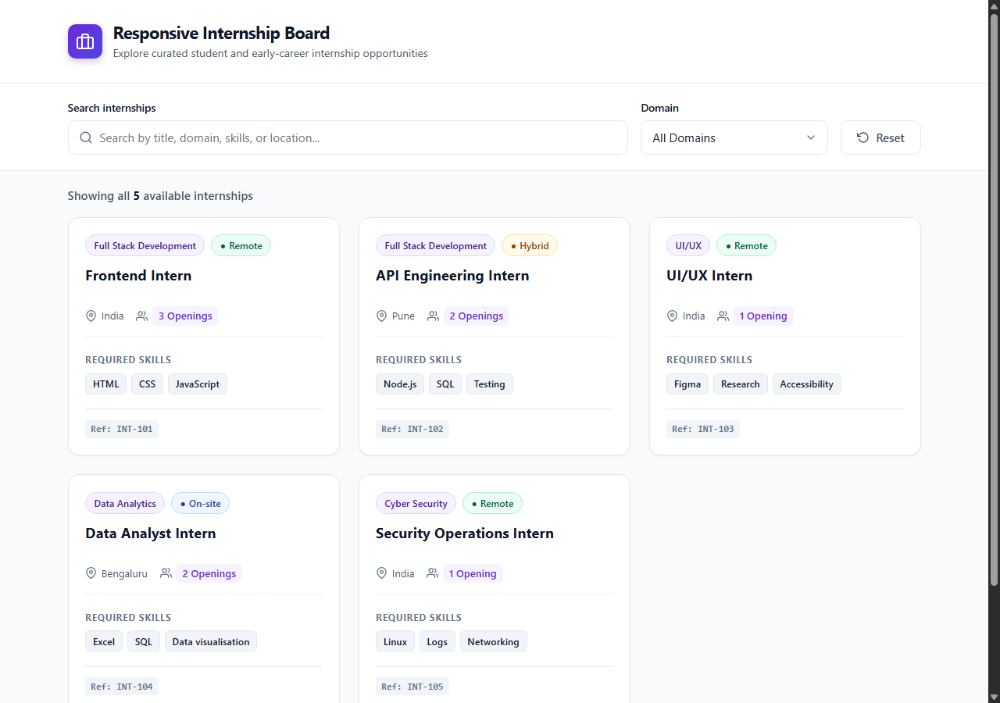
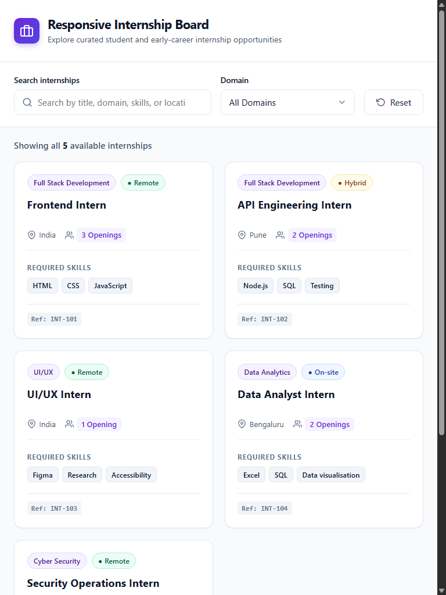
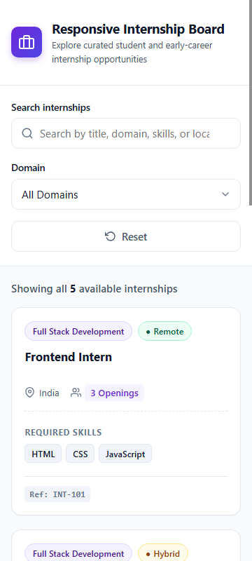
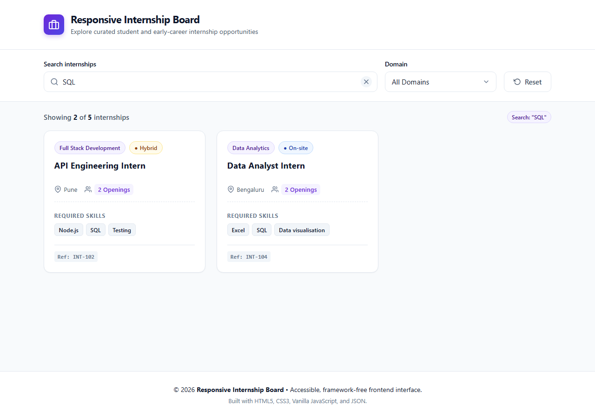
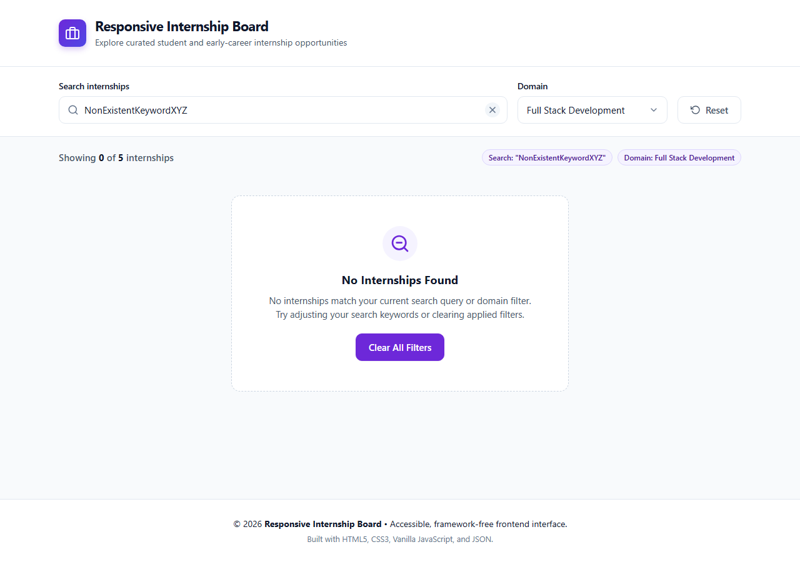
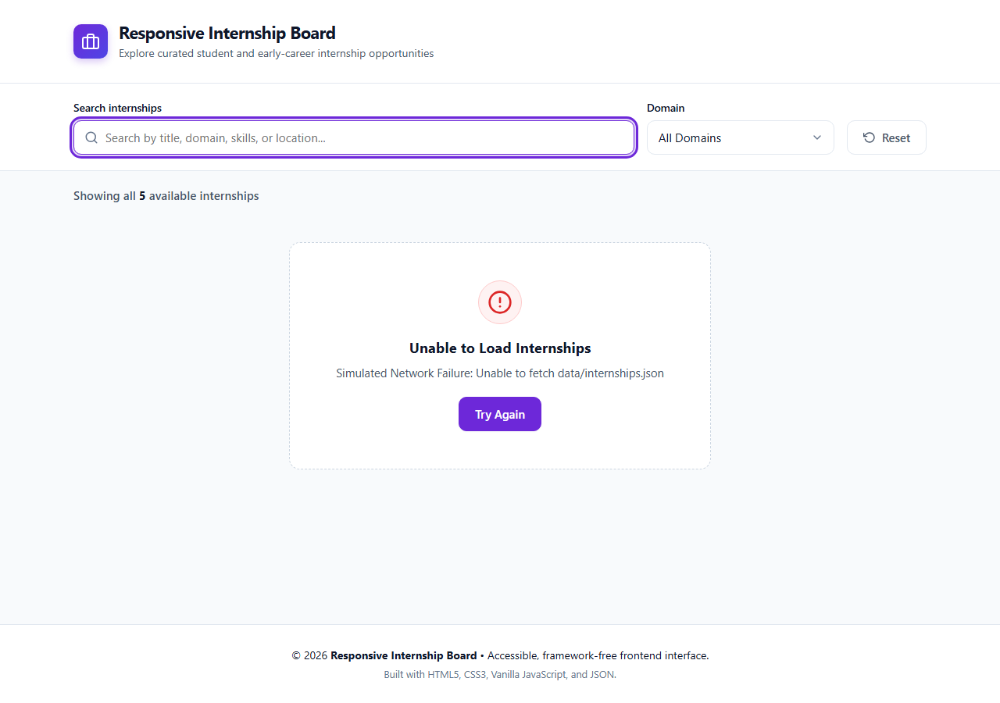

# Responsive Internship Board

An accessible, responsive, and framework-free internship listing interface built with modern semantic **HTML5**, **CSS3**, **Vanilla JavaScript (ES6+)**, and **JSON**.

This project provides an intuitive search and filtering experience for discovering student and early-career internship opportunities across engineering, design, data analytics, and cyber security.

---

## Table of Contents

- [Features](#features)
- [Design & Accessibility](#design--accessibility)
- [Technology Stack](#technology-stack)
- [Project Structure](#project-structure)
- [Responsive Testing & Breakpoints](#responsive-testing--breakpoints)
- [Screenshots](#screenshots)
- [How to Run Locally](#how-to-run-locally)
- [Automated Testing](#automated-testing)
- [Deployment & GitHub Instructions](#deployment--github-instructions)

---

## Features

- **Dynamic Data Rendering:** Loads internship cards dynamically from `data/internships.json` without hardcoding records.
- **Card Metadata:** Displays role title, domain, work mode (*Remote*, *Hybrid*, *On-site*), location, required skill badges, number of openings, and reference ID. Supports optional company name when provided in the dataset.
- **Real-Time Keyword Search:** Dynamically filters internships as you type across role title, domain, location, and required skills.
- **Dynamic Domain Filter:** Automatically extracts unique domains from the dataset and populates the dropdown filter options.
- **Simultaneous Filtering:** Keyword search and domain filter work in concert.
- **Complete UI States:**
  - **Default State:** Displays all available internships with total count announcement.
  - **Empty State:** Shows a clean, user-friendly message when no records match, including a one-click *"Clear All Filters"* button.
  - **Error State:** Catches network/parsing issues and presents a friendly error message along with a *"Try Again"* retry button.
  - **Loading State:** Displays a lightweight spinner while fetching data.

---

## Design & Accessibility

- **Visual Direction:** Clean, modern, minimal layout with a soft neutral background (`#f8fafc`), deep purple primary accent (`#6d28d9`), subtle borders, and rounded cards.
- **Semantic HTML5:** Built using `<header>`, `<main>`, `<section>`, `<form role="search">`, `<label for="...">`, and `<article>` tags.
- **Accessible Screen Reader Announcements:** Integrated ARIA live region (`aria-live="polite"` / `role="status"`) announces matching counts dynamically upon search or filter changes.
- **Keyboard Navigation:** Full keyboard navigation support (Tab / Shift+Tab, Enter, Space).
- **Focus Indicators:** High-contrast visible focus rings (`:focus-visible`) for all interactive elements.
- **Skip Link:** Includes a keyboard-accessible *"Skip to main content"* link at the top of the DOM.
- **WCAG AA Compliance:** Strict color contrast across text, badges, and interactive controls.

---

## Technology Stack

- **HTML5:** Semantic markup and accessibility landmarks.
- **CSS3:** Custom properties (CSS variables), CSS Grid, Flexbox, media queries (zero CSS frameworks).
- **Vanilla JavaScript (ES6+):** Pure DOM manipulation, Fetch API, and reactive state management (no frontend frameworks or external libraries).
- **JSON:** Seed dataset of internship records.

---

## Project Structure

```text
responsive-internship-board/
│
├── index.html              # Semantic HTML5 markup and structure
├── style.css               # Responsive styling, color variables, and media queries
├── script.js               # Vanilla JavaScript application and filtering logic
├── test_runner.js          # Automated headless Chrome / CDP test runner (zero dependencies)
├── data/
│   └── internships.json    # Supplied internship records seed dataset
├── screenshots/            # Automated test captures across viewports and UI states
│   ├── desktop-1280px.png
│   ├── tablet-768px.png
│   ├── mobile-360px.png
│   ├── search-filter-active.png
│   ├── empty-state.png
│   └── error-state.png
└── README.md               # Project documentation and guide
```

---

## Responsive Testing & Breakpoints

The board is tested and verified across standard device viewports:

| Viewport | Target Device | Layout Behavior | Result |
| :--- | :--- | :--- | :--- |
| **360px** | Mobile Devices | 1-column card list, stacked controls, full touch targets (44px min height), no horizontal overflow. | ✅ Pass |
| **768px** | Tablets / Small Laptops | 2-column responsive grid, inline flex filter controls, balanced spacing. | ✅ Pass |
| **1024px+** | Desktop & Ultra-wide | 3-column grid (`repeat(3, 1fr)`), comfortable gutters, cards hover lift. | ✅ Pass |

---

## Screenshots

### 1. Desktop View (1280px)


### 2. Tablet View (768px)


### 3. Mobile View (360px)


### 4. Real-time Search & Filter Active


### 5. Empty State (Zero Matches)


### 6. Error State (Network Failure & Retry)


---

## How to Run Locally

Because the application fetches `data/internships.json` via the native `fetch` API, it must be served through a local HTTP server (browsers restrict `file://` fetch due to CORS security policies).

### Option 1: Python (Built-in)
```bash
# Navigate to the project directory
cd "Responsive Board"

# Start a simple HTTP server on port 8000
python -m http.server 8000
```
Open your browser and navigate to: `http://localhost:8000`

### Option 2: Node.js (Built-in `npx serve`)
```bash
npx serve .
```

### Option 3: VS Code Live Server
Right-click on `index.html` and select **"Open with Live Server"**.

---

## Automated Testing

An automated headless Chrome test runner (`test_runner.js`) is included. It tests all 25 criteria without external dependencies using native Node.js APIs and the Chrome DevTools Protocol (CDP).

To execute the test suite:
```bash
node test_runner.js
```

### Test Suite Coverage:
- [x] Initial JSON fetch and dynamic 5 cards rendering
- [x] Correct card metadata fields (Title, Domain, Mode, Location, Openings, Skills, ID)
- [x] Dynamic generation of domain options in `<select>`
- [x] Search by skill (`SQL`) returning matching cards
- [x] Search by role title (`Security`) returning matching card
- [x] Search by location (`Bengaluru`) returning matching card
- [x] Domain filtering (`Full Stack Development`, `Cyber Security`)
- [x] Combined simultaneous search and domain filtering
- [x] Empty state display upon zero matches and reset button functionality
- [x] Associated `<label>` elements for inputs and controls
- [x] Screen reader `aria-live` status announcements
- [x] Keyboard focus visible rings
- [x] Error state UI rendering and retry button
- [x] Viewport captures at 1280px, 768px, and 360px

---

## Deployment & GitHub Instructions

To complete the final submission requirement (one public repository link or live preview):

### Step 1: Initialize Git and Push to GitHub
```bash
git init
git add .
git commit -m "feat: complete responsive internship board with search, filters, and tests"
git branch -M main
git remote add origin https://github.com/<your-username>/responsive-internship-board.git
git push -u origin main
```

### Step 2: Deploy to GitHub Pages (Free)
1. Go to your repository on GitHub.
2. Navigate to **Settings** > **Pages**.
3. Under **Branch**, select `main` and root directory `/ (root)`.
4. Click **Save**.
5. Your live URL will be active at: `https://<your-username>.github.io/responsive-internship-board/`
